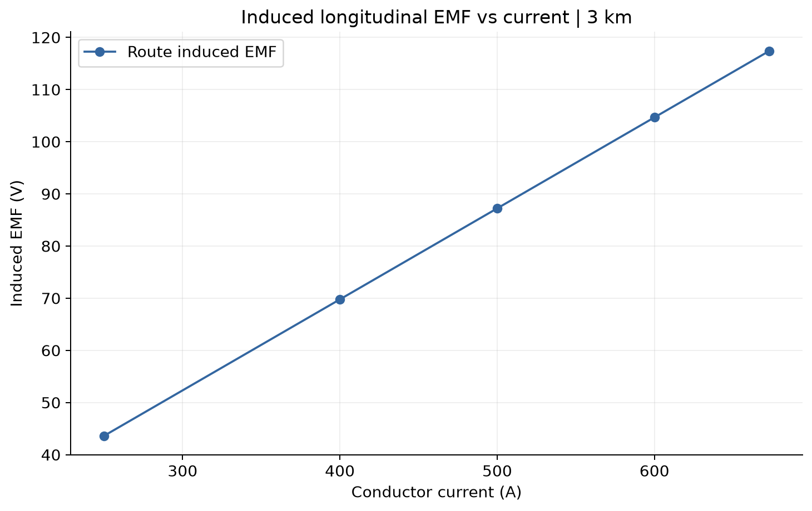
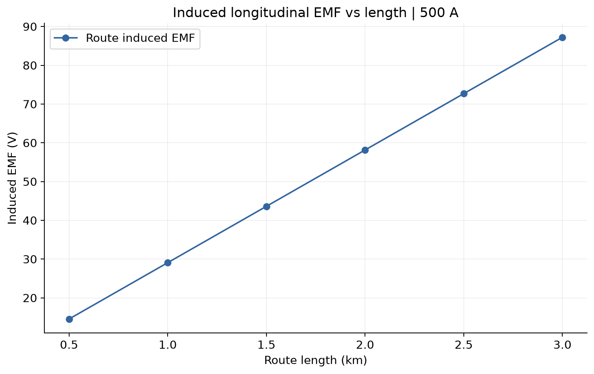
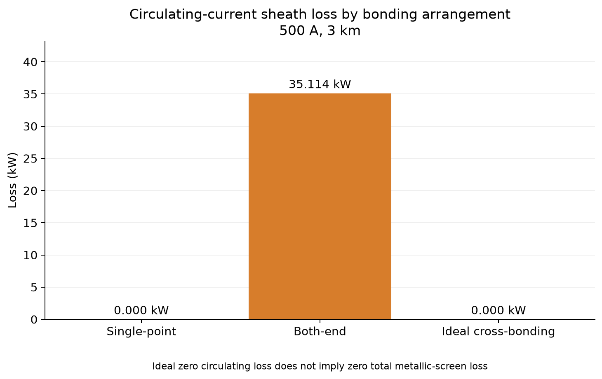
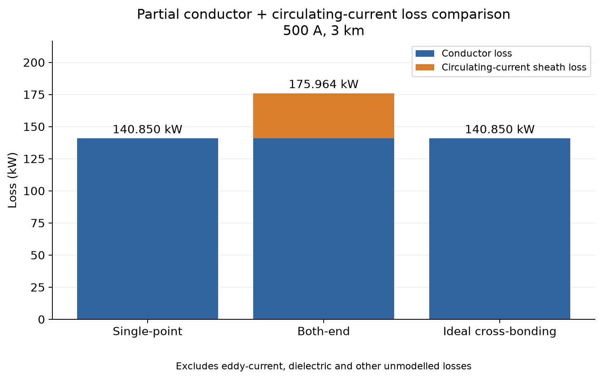
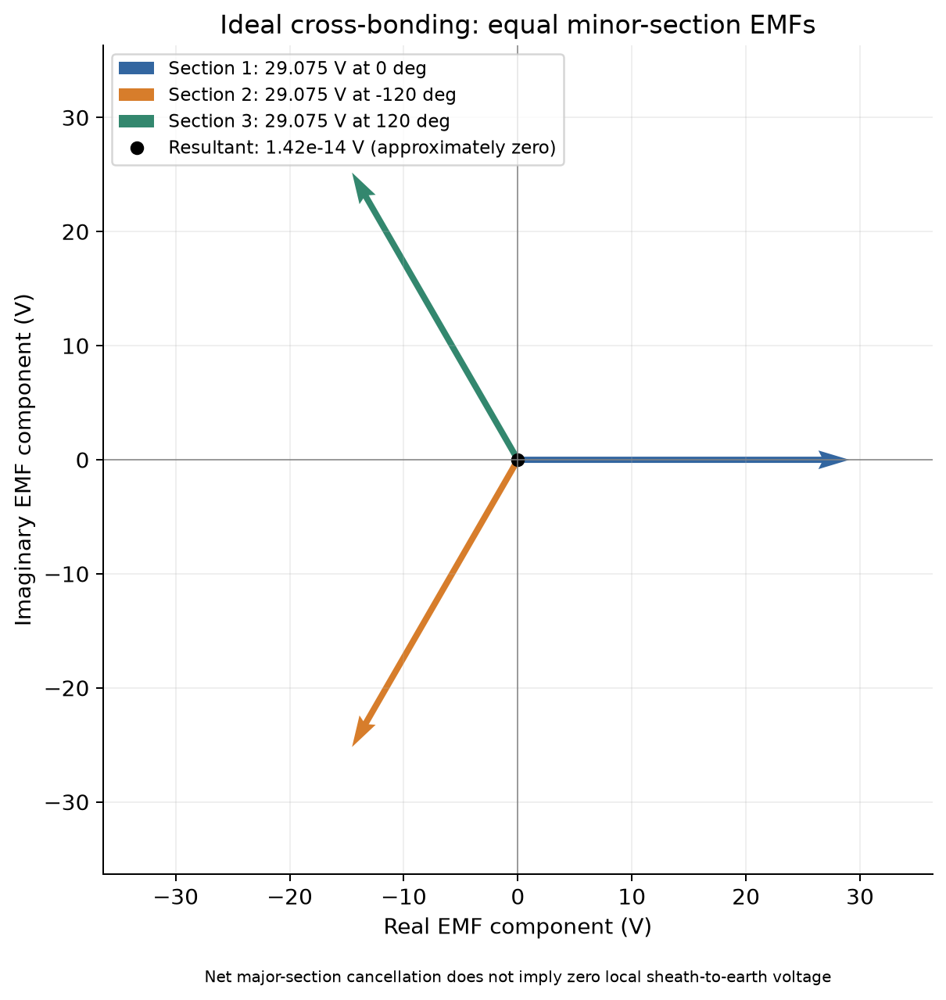

# HV Cable Bonding, Sheath Voltage & Loss Study

**A 132 kV underground cable study comparing single-point bonding, both-end bonding and ideal cross-bonding**, using handwritten calculations, an Excel model, and a reproducible Python analysis.

This portfolio project investigates how metallic-screen bonding arrangements influence **induced longitudinal sheath EMF, circulating current and associated resistive losses**. It also discusses the purpose of sheath voltage limiters (SVLs) and the considerations involved in a preliminary protection assessment.

> **Engineering scope:** This is an illustrative, simplified analysis, **not an installation design or an IEC 60287-compliant cable-loss/ampacity assessment**. The assumed 65 mm mean screen diameter and the equivalent bonding-loop impedance of **0.45 + j0.30 Ω** have not been verified from the manufacturer's cable data. Results derived from them should not be treated as verified installation predictions.

## Study objectives

- Examine how induced sheath EMF changes with conductor current and route length.
- Compare **single-point**, **both-end**, and **ideal cross-bonded** metallic-screen arrangements.
- Estimate circulating-current sheath losses and their ratio to conductor losses in a simplified equivalent-loop model.
- Demonstrate ideal cross-bonding phasor cancellation for three equal minor sections.
- Document the role of **SVLs** and the checks required before selecting real protection equipment.
- Cross-check calculations through handwritten working, Excel formulas and Python tests.

## Cable selection and assumptions

The reference cable is **Liban Cables / Nexans H10A4DP011126**, a **76/132 (145) kV, single-core 1 × 630/50 mm²** cable with aluminium conductor and copper metallic screen.

| Parameter | Value | Basis |
|---|---:|---|
| Nominal line-to-line voltage | 132 kV | Study operating condition |
| Frequency | 50 Hz | Study condition |
| Conductor current | 500 A | Study base case |
| Route length | 3 km | Study base case |
| Conductor AC resistance at 90°C | 0.0626 Ω/km | Manufacturer specification |
| Nominal overall cable diameter | 82 mm | Manufacturer specification |
| Metallic-screen cross-section | 50 mm² | Manufacturer specification |
| Centre-to-centre spacing | 82 mm | Assumed touching trefoil geometry |
| Mean metallic-screen diameter | 65 mm | **Illustrative assumption; unverified** |
| Equivalent loop impedance | 0.45 + j0.30 Ω | **Illustrative assumption; unverified** |
| Equivalent resistive loss path | 0.45 Ω per phase | **Illustrative assumption; not measured screen resistance** |
| Cross-bonding model | Three equal 1 km sections | Ideal balanced assumption |

**Manufacturer source:** [Liban Cables / Nexans product datasheet — H10A4DP011126](https://www.libancables.com/.rest/catalog/v1/product/pdf/H10A4DP011126).

## Method

The analysis uses the following preliminary relationships:

```text
Angular frequency:             ω = 2πf
Sheath reactance per km:        Xs = 2ω × 10⁻⁷ × ln(2s/d) × 1000
Induced longitudinal EMF:      Es = I × Xs × L
Three-phase conductor loss:    Pc = 3 × I² × Rc × L / 1000              [kW]
Equivalent circulating current: Is = Es / Zloop
Circulating-current loss:      Ps,circ = 3 × |Is|² × Rloss / 1000       [kW]
Circulating-current loss factor: λcirc = Ps,circ / Pc
```

The loss formula uses a separately declared **equivalent loss resistance**, not a manufacturer-confirmed metallic-screen resistance. For ideal cross-bonding, the three equal minor-section EMFs are added as complex phasors at **0°, −120° and +120°**.

## Base-case results

| Quantity | Calculated result |
|---|---:|
| Three-phase conductor losses | **140.850 kW** |
| Induced longitudinal EMF over 3 km | **87.224 V** |
| Both-end circulating-current magnitude | **161.278 A** |
| Both-end circulating-current losses | **35.114 kW** |
| Circulating-current loss factor (both-end) | **0.2493 (24.93%)** |
| Partial combined losses (both-end) | **175.964 kW** |
| Ideal cross-bonding resultant major-section EMF | **≈ 0 V** |

| Bonding arrangement | EMF quantity | Circulating current | Circulating-current loss |
|---|---|---:|---:|
| Single-point | Open-end induced EMF ≈ 87.224 V | 0 A (ideal) | 0 kW (ideal) |
| Both-end | Loop-driving EMF ≈ 87.224 V | 161.278 A | 35.114 kW |
| Ideal cross-bonding | Major-section resultant EMF ≈ 0 V | ≈ 0 A | ≈ 0 kW |

**Interpretation:** These EMF quantities describe different circuit conditions and **should not be compared as actual sheath-to-earth voltages at the same location**. An ideal zero circulating-current loss does **not** imply zero total metallic-screen loss or zero local sheath voltage. The partial combined-loss figure excludes dielectric, eddy-current and other unmodelled losses.

## Python results and figures

### Induced EMF sensitivity





### Bonding arrangement comparison





### Ideal cross-bonding phasor cancellation



[View the sixth chart: both-end circulating loss vs current](outputs/both_end_loss_vs_current.png).

The [`outputs/`](outputs/) directory also contains the five supporting CSV tables, including the current and length sensitivities, bonding comparison, loss comparison and phasor components.

## Sheath voltage limiter (SVL) assessment

An SVL is intended to remain substantially non-conductive during normal conditions and limit excessive sheath-to-earth voltage during appropriate overvoltage events, helping protect cable oversheaths and bonding accessories. This project discusses SVL applications at insulated sheath connections and sectionalizing joints.

The **87.224 V** result is a *simplified normal induced EMF*, **not sufficient to select an SVL rating**. Proper selection would require fault and transient voltages, protective level, continuous/temporary voltage duty, energy withstand, bonding arrangement, lead effects and insulation-coordination checks.

A real equipment family discussed as a **manufacturer documentation example**, not an approved selection, is [TE Connectivity / Raychem HVLB-SICO](https://www.te.com/en/product-CAT-HVLB-SICO.html). Refer to the technical report for the preliminary discussion.

## Project deliverables

| Deliverable | Location |
|---|---|
| Final technical report (PDF) | [HV_Cable_Bonding_Technical_Report_Expanded_v3.pdf](report/HV_Cable_Bonding_Technical_Report_Expanded_v3.pdf) |
| Original handwritten calculations (PDF) | [HV_Cable_Bonding_Sheath_Voltage_Loss_Hand_Calculations.pdf](hand%20calculation/HV_Cable_Bonding_Sheath_Voltage_Loss_Hand_Calculations.pdf) |
| Excel model (five worksheets and four charts) | [HV_Cable_Bonding_Sheath_Voltage_Loss_Study.xlsx](excel/HV_Cable_Bonding_Sheath_Voltage_Loss_Study.xlsx) |
| Python calculation and plotting script | [analysis.py](analysis.py) |
| Generated graphs and CSV datasets | [outputs/](outputs/) |
| Automated tests | [tests/test_analysis.py](tests/test_analysis.py) |

The hand-calculation file is intended to preserve the original notebook writing, including original corrections. The technical PDF provides the narrative and SVL discussion; the Python script and Excel workbook make the assumptions and results inspectable.

## Run the Python analysis

Use **Python 3.10 or newer**. From the repository root:

```bash
python -m pip install -r requirements.txt
python analysis.py
python -m pytest -q
```

The script prints the numerical study results and produces six PNG graphs and five CSV files in `outputs/`. To test another study current and route length without overwriting the baseline outputs:

```bash
python analysis.py --current-a 600 --length-km 3 --output-dir case_600A
```

The Python program was built incrementally: Stage 1 implemented and checked the calculations; Stage 2 added data exports and plots; Stage 3 added tests and documentation. **Only the corrected, integrated final program is included in this repository.**

